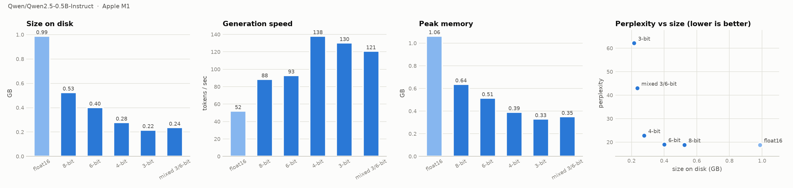

# QuantBench

How much speed and memory do you gain by quantizing an LLM, and how much quality do you give up?
QuantBench answers that on your own Mac. It converts one Hugging Face model into several precisions
with [MLX](https://github.com/ml-explore/mlx), then measures each one the same way.

| Metric | How it's measured |
|---|---|
| Size on disk | Total size of the `.safetensors` files |
| Bits per weight | Effective bits, including quantization scales and biases |
| Time to first token | Wall-clock time until the first token is generated |
| Prompt / generation tokens per sec | Median of N greedy runs after one warm-up run |
| Peak memory | MLX peak allocation during generation |
| Perplexity | Next-token perplexity on the same WikiText-2 windows for every variant (± standard error) |

## Setup

```bash
cd quantbench
source .venv/bin/activate
pip install -e ".[dev]"
```

## Usage

```bash
# Default: Qwen2.5-0.5B-Instruct as fp16, 8, 6, 4, 3-bit and mixed 3/6-bit
quantbench run

# Pick a model and variants
quantbench run --model Qwen/Qwen2.5-1.5B-Instruct --variants fp16,8,4,4g32,mixed_4_6

# Quick check
quantbench run --variants fp16,4 --runs 1 --max-tokens 64 --ppl-samples 8

# Re-print the table and re-draw the chart from saved results
quantbench report results/Qwen2.5-0.5B-Instruct/results.json
```

Variant names: `fp16`, `bf16`, a bit width (`8`, `6`, `5`, `4`, `3`, `2`), an optional group size
(`4g32`; the default is 64), or an mlx-lm mixed recipe (`mixed_2_6`, `mixed_3_4`, `mixed_3_6`,
`mixed_4_6`). A mixed recipe keeps the most sensitive layers at higher precision, similar to
llama.cpp's `Q4_K_M`.

The model you pass must be **unquantized** (fp16/bf16 weights). Converted models are cached in
`models/`, so a second run skips conversion.

Outputs go to `results/<model>/`:
- `results.json`: raw numbers plus machine and settings info
- `results.csv`: the same table, with columns relative to the baseline
- `summary.png`: size, speed, memory and perplexity-vs-size charts

### Memory on an 8 GB Mac

The fp16 copy needs about 2 bytes per parameter. Models up to about 1.5B parameters are comfortable
here, 3B fits, and 7B+ should skip `fp16` (start from `8`). If perplexity runs out of memory, use
`--batch-size 1` or `--seq-len 256`.

## Example: Qwen2.5-0.5B-Instruct on an M1 (8 GB)

Default run (`quantbench run`: 3 timed runs of 128 tokens, 64 × 512-token perplexity windows):

| Variant | Size | bpw | Gen tok/s | Peak mem | PPL |
|---|---|---|---|---|---|
| float16 | 0.99 GB | 16.00 | 52.0 | 1.06 GB | 18.73 |
| 8-bit | 0.53 GB | 8.50 | 88.5 (1.70×) | 0.64 GB | 18.77 (+0.2%) |
| 6-bit | 0.40 GB | 6.50 | 92.9 (1.79×) | 0.51 GB | 18.94 (+1.1%) |
| 4-bit | 0.28 GB | 4.50 | 138.1 (2.65×) | 0.39 GB | 22.74 (+21.4%) |
| 3-bit | 0.22 GB | 3.50 | 130.2 (2.50×) | 0.33 GB | 62.13 (+231.7%) |
| mixed 3/6-bit | 0.24 GB | 3.83 | 120.7 (2.32×) | 0.35 GB | 42.95 (+129.2%) |



What it shows:
- **8-bit and 6-bit are almost free.** They are 2–2.5× smaller and about 1.7–1.8× faster, with
  perplexity within about 1% of fp16.
- **4-bit is the fastest** (2.65×) at a visible quality cost (+21%) on a model this small.
- **3-bit falls apart** (+232%), and it isn't even faster than 4-bit. On this chip the 3-bit
  dequantization costs more time than the memory it saves.
- **The mixed 3/6 recipe recovers about half of the 3-bit loss** for 0.02 GB more. Keeping the
  sensitive layers at 6 bits matters.

Token generation is limited by memory bandwidth: each new token reads every weight once. That's
why fewer bits mean faster generation, down to about 4 bits. Small models lose more quality to
quantization than large ones, so expect much smaller perplexity gaps on a 3B or 7B model.

## Layout

```
src/quantbench/
  variants.py   parse variant specs (fp16, 4, 4g32, mixed_3_6, ...)
  quantize.py   convert and cache each variant with mlx_lm.convert
  speed.py      TTFT, tokens/sec, peak memory
  quality.py    WikiText-2 perplexity
  runner.py     runs every variant and saves results.json after each one
  report.py     table, CSV and chart
  cli.py        `quantbench run` / `quantbench report`
tests/          unit tests (no downloads needed): pytest
```

Related: `../inference_optimization.py` benchmarks general PyTorch inference speed-ups
(inference_mode, half precision, torch.compile, INT8, TorchScript, ONNX) on a small MLP.
